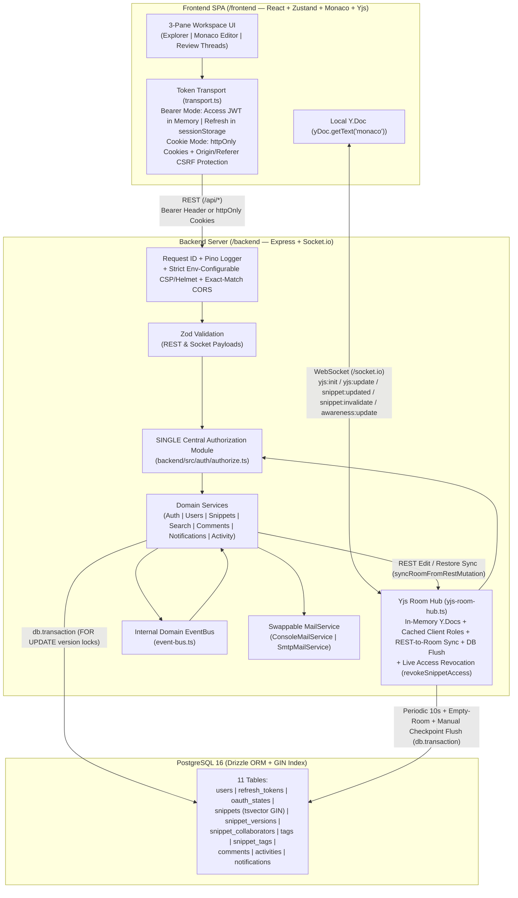

# CodeCollab — Collaborative Code Snippet Sharing & Review Platform

A production-grade software engineering platform combining **Gists-style versioned code snippets**, **Google Docs-style live CRDT co-editing (Yjs + Monaco + Socket.io)**, **GitHub-style per-line threaded review comments with outdated-line detection**, and **PostgreSQL `tsvector` + `GIN` full-text search**.

---

## 1. Tech Stack & Engineering Rationale

| Layer | Technology | Rationale |
| :--- | :--- | :--- |
| **Frontend (`/frontend`)** | React 19, TypeScript, Vite, Tailwind CSS v4, Zustand | Self-contained SPA owning its own `package.json`, `tsconfig.json`, `vite.config.ts`, `index.html`, and `Dockerfile` with deterministic state slices (`authStore`, `snippetStore`, `realtimeStore`). |
| **Code Editor & CRDT** | `@monaco-editor/react`, `monaco-editor`, `yjs`, `y-monaco`, `socket.io-client` | Yjs provides conflict-free replicated data types (CRDTs) for concurrent multi-user editing and reconnect state-vector resynchronization (`yjs:sync-step1` / `yjs:sync-step2`). |
| **Backend (`/backend`)** | Node.js, Express, TypeScript (`tsx`), Socket.io, Zod, Pino, Helmet, `express-rate-limit` | Self-contained server owning its own `package.json`, `tsconfig.json`, `drizzle.config.ts`, `src/db/schema.ts`, `src/db/index.ts`, and `Dockerfile`. Zod validates every REST route and Socket.io payload; Pino logs structured JSON correlated by `X-Request-Id`. |
| **Database & ORM** | PostgreSQL 16, Drizzle ORM (`drizzle-orm`, `pg`), `drizzle-kit` | Single config module (`backend/src/config/env.ts`) resolves `DATABASE_URL` (with optional `DB_SSL`) first and falls back to `SQL_*` variables only if `DATABASE_URL` is absent. Uses `drizzle-kit migrate` to apply committed SQL migrations (`backend/drizzle/0000_init.sql`). |
| **Testing** | Vitest + Supertest + `socket.io-client` | Feature-named integration tests covering environment/DB config, RBAC & refresh rotation, snippet transactions & email privacy, weighted `tsvector` FTS, live Yjs rooms & REST-to-Yjs synchronization, threaded line comments, activity feeds, and OpenAPI docs. |

---

## 2. Architecture Diagram (Mermaid)



---

## 3. Setup & Running Instructions

### Step 1: Generate JWT Secrets & Configure Environment

CodeCollab uses cryptographic HMAC-SHA256 tokens for session security:
- **`JWT_ACCESS_SECRET`**: Signs short-lived access tokens (15-minute validity).
- **`JWT_REFRESH_SECRET`**: Signs long-lived session refresh tokens (7-day validity).

> [!IMPORTANT]
> **Secret Requirements:**
> 1. Both secrets **must be at least 32 characters** long.
> 2. `JWT_ACCESS_SECRET` and `JWT_REFRESH_SECRET` **must be completely different values**.
> 3. The backend server and Docker Compose will actively refuse to boot if either secret is empty, uses a placeholder, or if they match.

#### 1. Copy the environment template
At the root of the project:
```bash
cp .env.example .env
```
*(Never commit `.env` to Git; it is already ignored in `.gitignore`).*

#### 2. Generate two distinct 32-byte (64-character) hex secrets
Run the secret generator command **twice** in your terminal to obtain two unique strings:

- **Using Node.js (Cross-platform — Windows, macOS, Linux):**
  ```bash
  node -e "console.log(require('crypto').randomBytes(32).toString('hex'))"
  ```
- **Or using OpenSSL (macOS, Linux, Git Bash):**
  ```bash
  openssl rand -hex 32
  ```
- **Or using PowerShell (Windows native):**
  ```powershell
  -join ((1..32) | ForEach-Object { '{0:x2}' -f (Get-Random -Max 256) })
  ```

#### 3. Add the secrets to your `.env` file
Open `.env` in your text editor and set the two generated strings:
```env
JWT_ACCESS_SECRET=paste_first_generated_secret_here
JWT_REFRESH_SECRET=paste_second_different_secret_here
```
*(All other configuration variables in `.env` come pre-configured for local evaluation).*

---

### Step 2: What to Do After (Choose Your Run Mode)

Once your secrets are set in `.env`, choose how you want to run CodeCollab:

#### Option A: Run with Docker Compose (Recommended All-in-One)

Build and start the complete production stack (PostgreSQL 16, Express Backend API, and Nginx Frontend) in one command:

```bash
docker compose up --build
```

- **Web Application**: Open [http://localhost:8080](http://localhost:8080) in your browser.
- **REST API & WebSockets**: Served directly at [http://localhost:8080/api](http://localhost:8080/api) and [http://localhost:8080/socket.io](http://localhost:8080/socket.io).
- **Interactive OpenAPI Documentation**: Swagger UI available at [http://localhost:8080/api/docs](http://localhost:8080/api/docs).
- **Stopping the stack**: Press `Ctrl+C` or run `docker compose down`.

**Configuration Notes for Docker Compose**:
- `AUTH_TRANSPORT` defaults to `bearer` for local runs. Cookie mode is opt-in by setting `AUTH_TRANSPORT=cookie` and `COOKIE_SECURE=true` in production (or `COOKIE_SECURE=false` for local non-TLS testing).
- `OAUTH_STATE_SECRET` is derived (HMAC-SHA256 of `JWT_ACCESS_SECRET`) only when `LOCAL_DEMO=true`, which is the compose default. Real deployments must set `LOCAL_DEMO=false` and provide their own `OAUTH_STATE_SECRET`.
- `backend/Dockerfile`: Multi-stage build producing a non-root container running `sh -c "npx drizzle-kit migrate && npx tsx src/index.ts"` on port `4000`.
- `frontend/Dockerfile`: Multi-stage build compiling static Vite assets and serving them through an `nginx:1.27-alpine` container on port `80` with SPA routing and security headers (CSP and Permissions-Policy).

---

#### Option B: Run Locally Without Docker (Hot-Reloading Dev Mode)

1. **Start PostgreSQL**:
   Start a local PostgreSQL server on port `5432`, or launch the lightweight dev container:
   ```bash
   docker compose -f docker-compose.dev.yml up -d postgres
   ```
2. **Install workspace dependencies**:
   ```bash
   npm install
   ```
3. **Configure workspace environment files**:
   ```bash
   cp backend/.env.example backend/.env
   cp frontend/.env.example frontend/.env
   ```
   *Make sure `backend/.env` also contains your generated `JWT_ACCESS_SECRET` and `JWT_REFRESH_SECRET` and that `DATABASE_URL` matches your local database.*
4. **Apply Drizzle SQL migrations & seed sample data**:
   ```bash
   npm run migrate
   npm run seed
   ```
5. **Start dev servers**:
   ```bash
   npm run dev
   ```
   *(Or start them individually via `npm run dev:backend` on port 4000 and `npm run dev:frontend` on port 5173).*
   Open [http://localhost:5173](http://localhost:5173) in your browser. During development, Vite automatically proxies `/api` and `/socket.io` to the backend on port 4000.

6. **Sign in or register an account**:
   - Click **Register** on the top navigation to create a new user.
   - Or log in with pre-seeded test accounts:
     - **Admin**: `admin_alex` / `AdminPass123!`
     - **Editor**: `elena_dev` / `EditorPass123!`
     - **Viewer**: `victor_read` / `ViewerPass123!`

### Optional GitHub Login Setup
GitHub OAuth authentication is entirely optional and zero-configuration by default:
- **Zero-Config Behavior**: When `GITHUB_CLIENT_ID` and `GITHUB_CLIENT_SECRET` are unset or set to placeholder values, `GET /api/auth/providers` reports `{ github: false, passwordLogin: true }`. The frontend dynamically hides the "Continue with GitHub" button on sign-in and register dialogs with zero errors. Standard email and password login functions completely without GitHub configuration.
- **Configuring a GitHub OAuth App**:
  1. In GitHub Settings &rarr; Developer Settings &rarr; OAuth Apps, create a new OAuth App:
     - **Application name**: `CodeCollab Local`
     - **Homepage URL**: `http://localhost:8080` (or `http://localhost:5173` for host dev)
     - **Authorization callback URL**: `http://localhost:8080/api/auth/github/callback` (or `http://localhost:4000/api/auth/github/callback` for backend-only dev)
  2. Set `GITHUB_CLIENT_ID` and `GITHUB_CLIENT_SECRET` in your environment or `.env` file.
  3. The popup flow opens `GET /api/auth/github/start?origin=<app origin>`, sets an `httpOnly`, `SameSite=Lax`, `path=/api/auth` state cookie, and safely exchanges the authorization code upon redirect.
  4. New users signing in via GitHub are granted global role `editor` (never `admin`).
  5. Accounts created via GitHub without a password can set a local password from their Profile Settings within 5 minutes of sign-in (`authTime <= 300s`). Real email addresses can be updated if the account was registered with an unverified or hidden GitHub placeholder email (`@users.noreply.github.com`).

---

## 4. Running Tests & Typechecking

Run the complete backend and frontend test suites sequentially:
```bash
npm test
```

Run individual feature test suites:
```bash
npx vitest run backend/src/__tests__/foundation-health.test.ts
npx vitest run backend/src/__tests__/auth-rbac.test.ts
npx vitest run backend/src/__tests__/env-normalization.test.ts
npx vitest run backend/src/__tests__/github-auth.test.ts
npx vitest run backend/src/__tests__/snippets-versions.test.ts
npx vitest run backend/src/__tests__/search-fts.test.ts
npx vitest run backend/src/__tests__/realtime-yjs.test.ts
npx vitest run backend/src/__tests__/comments-notifications.test.ts
npx vitest run backend/src/__tests__/activity-feeds.test.ts
npx vitest run backend/src/__tests__/openapi-docs.test.ts
npx vitest run backend/src/__tests__/security-regressions.test.ts
npx vitest run frontend/src/__tests__/frontend-utils.test.ts
```

Run TypeScript typechecking, environment schema parity, secret scanning, and production frontend build verification:
```bash
npm run lint
npm run check:env
npm run check:secrets
npm run build
```

---

## 5. Environment Variables Reference

| Variable | Required | Default | Description |
| :--- | :---: | :--- | :--- |
| `NODE_ENV` | No | `development` | `development` \| `test` \| `production` |
| `PORT` | No | `3000` | HTTP + Socket.io server port (set to 4000 in Docker compose). |
| `DATABASE_URL` | Yes* | — | Primary PostgreSQL connection URI (`postgresql://...`). Falls back to `SQL_*` if unset/empty. |
| `DB_SSL` | No | `false` | Optional SSL mode (`true` \| `false` \| `require` \| `no-verify`). In `production`, requires valid certificates unless `no-verify` is explicitly set. |
| `DB_SSL_CA` | No | `""` | Custom CA certificate string/path for validating database TLS certificates. |
| `LOCAL_DEMO` | No | `false` | When `true` (the docker compose default), the backend may derive `OAUTH_STATE_SECRET` and may run cookie transport without Secure cookies, and it logs a warning at boot. It never relaxes the JWT secret length or placeholder checks. Set it to `false` for any real deployment. |
| `TRUST_PROXY_HOPS` | No | `0` | Number of trusted upstream reverse proxies. When `0`, spoofed `X-Forwarded-For` headers are strictly ignored. |
| `JWT_ACCESS_SECRET` | Yes (Prod) | Ephemeral random in dev/test | Secret key (>= 32 chars in production) for signing 15-minute `HS256` JWT access tokens. |
| `JWT_ACCESS_SECRET_PREVIOUS` | No | `""` | Previous access secret for zero-downtime key rotation. |
| `JWT_REFRESH_SECRET` | Yes (Prod) | Ephemeral random in dev/test | Secret pepper (>= 32 chars in production) for SHA-256 hashing opaque refresh tokens. |
| `JWT_REFRESH_SECRET_PREVIOUS` | No | `""` | Previous refresh secret for zero-downtime key rotation. |
| `OAUTH_STATE_SECRET` | Yes (Prod, unless `LOCAL_DEMO=true`) | Derived from JWT_ACCESS_SECRET only in dev/test or `LOCAL_DEMO` | HMAC secret (>= 32 chars in production) used to sign short-lived OAuth state tokens. |
| `HEALTH_CHECK_SECRET` | No | `""` | Secret header required for `/api/health/ready` when called by unauthenticated external monitoring probes. |
| `AUTH_RATE_LIMIT_MAX` | No | `25` | Maximum login/registration attempts per 15-minute window per IP + identifier key (500 in test). |
| `API_RATE_LIMIT_MAX` | No | `120` | Maximum general API requests per 1-minute window (1000 in test). |
| `AUTH_TRANSPORT` | No | `bearer` | `bearer` (in-memory access token + `sessionStorage` refresh token) \| `cookie` (`httpOnly` cookies with CSRF defense). |
| `COOKIE_SECURE` | No | `false` | Sets `Secure` attribute on auth cookies (`true` required in production cookie mode). |
| `COOKIE_SAME_SITE` | No | `lax` | `lax` \| `strict` \| `none` for cookie transport. |
| `APP_URL` | No | `http://localhost:3000` | Public application origin included in exact-match CORS and OAuth allowlists (set to 8080 in compose). |
| `CORS_ORIGINS` | No | `http://localhost:3000,http://localhost:5173` | Comma-separated exact-match allowlist of allowed browser origins for Express CORS and Socket.io. |
| `OAUTH_ALLOWED_ORIGINS` | No | Inherits `CORS_ORIGINS` + `APP_URL` | Comma-separated exact-match allowlist of origins permitted in GitHub OAuth state & `postMessage`. |
| `CSP_FRAME_ANCESTORS` | No | `'none'` | Env-configurable `frame-ancestors` directive (strict `'none'` by default). |
| `CSP_SCRIPT_SRC` / `CSP_STYLE_SRC` / `CSP_CONNECT_SRC` | No | `'self'` / `'self' 'unsafe-inline'` / `'self' ws: wss:` | Strict Content Security Policy directives (no `'unsafe-inline'` or `'unsafe-eval'` in script-src). |
| `GITHUB_CLIENT_ID` / `GITHUB_CLIENT_SECRET` | No | `""` | GitHub OAuth App credentials for popup login. |
| `GITHUB_CALLBACK_URL` | No | `${APP_URL}/api/auth/github/callback` | Configurable OAuth redirect URI. |
| `MAIL_PROVIDER` | No | `console` | `console` (`ConsoleMailService`) \| `smtp` (`SmtpMailService`). |
| `SMTP_HOST` / `SMTP_PORT` / `SMTP_USER` / `SMTP_PASS` / `SMTP_FROM` | No | `""` / `587` | SMTP server configuration when `MAIL_PROVIDER=smtp`. |
| `VITE_API_URL` | No | `""` (same origin) | Base URL for frontend REST and Socket.io requests. In local dev, Vite proxies `/api` and `/socket.io`. |
| `VITE_AUTH_TRANSPORT` | No | `bearer` | Client-side transport mode (`bearer` \| `cookie`). |

---

## 6. Development Seed Accounts (`npm run seed`)

> **Security Note**: Demo credentials and preset accounts are **strictly excluded** from production builds (`scripts/assert-no-demo-creds.mjs`). In production environments, initial administrative access is provisioned securely out-of-band.

During local development and testing, `npm run seed` creates sample users with the following roles:

| Role | Username | Email | Dev Capabilities |
| :--- | :--- | :--- | :--- |
| **Admin** | `admin_alex` | `admin@codecollab.dev` | Full access to all snippets, comments, user emails, and `/api/users/:id/role` role management. |
| **Editor 1** | `elena_dev` | `elena@codecollab.dev` | Owns public JWT & private crypto snippets; can create/edit snippets & manage collaborators. |
| **Editor 2** | `marcus_code` | `marcus@codecollab.dev` | Owns unlisted pgPool snippet; collaborator (`editor`) on Elena's public snippet. |
| **Viewer** | `victor_read` | `victor@codecollab.dev` | Global `viewer`: can view snippets, join live rooms read-only, and post comments; **blocked from creating or editing snippets over REST or WebSocket**. |

---

## 7. Security & Real-Time Consistency Highlights

- **Exact-Match Origin Allowlists**: Express CORS (`backend/src/app.ts`), Socket.io CORS (`backend/src/realtime/socket-server.ts`), and GitHub OAuth state/popup origins (`backend/src/auth/github-oauth.ts`) validate origins strictly against `CORS_ORIGINS` / `OAUTH_ALLOWED_ORIGINS` / `APP_URL` with no wildcard `.run.app` or substring `localhost` checks.
- **Verified-Only GitHub Email Linking**: `LiveGitHubOAuthProvider` inspects `/user/emails` for `verified: true`, and `upsertGitHubUser` refuses to link a GitHub login to an existing account unless GitHub marks the email verified (`403 GITHUB_EMAIL_UNVERIFIED`).
- **Strict-by-Default Env-Configurable CSP & Nginx Headers**: `backend/src/app.ts` defaults to `frame-ancestors 'none'`, `script-src 'self'`, `object-src 'none'`, and `connect-src 'self' ws: wss:`, configurable via `CSP_*` env vars. The production Nginx container (`frontend/nginx.conf`) enforces CSP and Permissions-Policy with worker blob support for Monaco.
- **Email & Search Content Privacy**: Collaborator emails on snippets (both in snippet detail `GET /api/snippets/:id` and search results `GET /api/search/snippets`) are returned only to the snippet owner or global `admin` (`null` for all other viewers/editors). Search results and snippet listings return lightweight summaries with an excerpt (`headline` + `contentLength`), omitting full `currentContent`. User emails in `GET /api/users` are returned only for the caller's own record or to global `admin`s.
- **Dual Rate Limiting**: Authentication endpoints enforce compound keys (`req.ip + ':' + sha256(identifier)`) to prevent targeted user lockout, paired with separate per-IP limiters on `/login`, `/register`, and OAuth endpoints.
- **Live-Room Consistency & Transactional Versions**: Version creation + snippet updates execute inside `db.transaction(...)` with pessimistic `FOR UPDATE` row locks. REST edits and version restores apply through `yjsRoomHub.syncRoomFromRestMutation` (which awaits `revokeSnippetAccess` when visibility changes to private, updates the in-memory `Y.Doc`, `latestVersionNumber`, `title`, and `tags`, and broadcasts `yjs:update` without leaking plaintext `content`).
